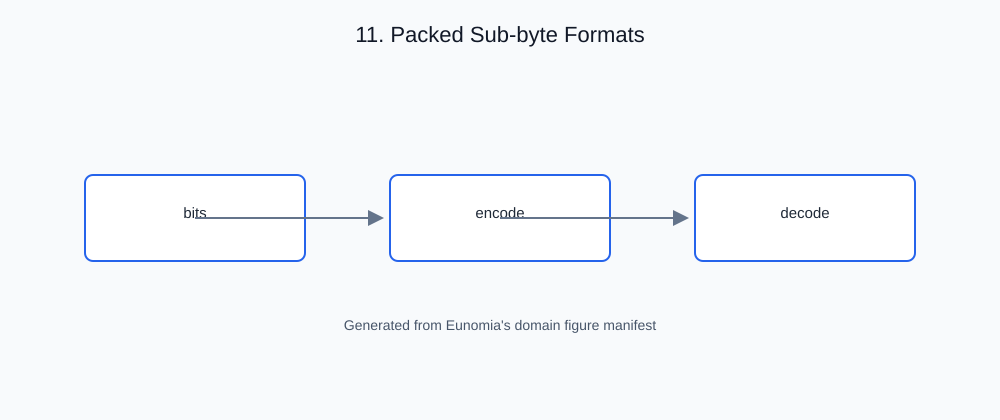

# 11. Packed Sub-byte Formats

<!-- generated-figure-start -->

*Figure 11.1 — Packed Sub-byte Formats*
<!-- generated-figure-end -->

## Governing equations

The sub-byte float formats (`F4` E3M0, `F8` E4M3, `Bf4` E2M1, `Bf8` E5M2)
are stored one per `u8`, wasting 4–7 bits per element. A *packed* layout
packs multiple sub-byte values into one storage word — two 4-bit values per
`u8` — trading a little unpack arithmetic for a 2× reduction in memory
footprint and bandwidth, which matters at scale for the storage layers of
the stack (GPU uploads, archives).

## The crate's abstraction

The `packed` module provides the storage vocabulary over these formats:

- **Buffers** — `Packed4Vec`/`PackedBf4Vec`/`PackedF4Vec` and
  `Packed4Slice`/`Packed4SliceMut` (+ per-format slices), with `Packed4Iter`.
- **COW** — `Packed4Cow`/`PackedBf4Cow`/`PackedF4Cow` for
  copy-on-write buffers that avoid copying until mutation.
- **Archival** — rkyv support (`ArchivedPacked4Cow`, `ArchivedPacked4Vec`,
  resolvers) under the `rkyv` feature, so packed buffers serialize without
  an allocation.
- **SIMD-accelerated unpack** — `unpack_f4_to_f32`, `unpack_bf4_to_bf16`,
  `unpack_f8_to_f32`, etc., with `unsafe_intrinsics` on `x86_64`/`aarch64`.

A borrowed packed slice can cover a buffer longer than its logical length.
When it becomes owned, only `ceil(len / 2)` bytes are copied, retaining the
unused high nibble of an odd-length final byte until the next append. Valid
archives with extra backing bytes remain readable; deserialization applies the
same owned-length rule. The borrowed view itself retains its original buffer.

```rust
# extern crate eunomia;
use eunomia::{Bf4, Packed4Cow, Packed4Slice};

let bytes = [0x21, 0x43];
let view = Packed4Slice::<Bf4>::new(&bytes, 1).expect("one packed element");
let mut owned = Packed4Cow::borrowed(view).into_owned();
owned.push(Bf4(3));
assert_eq!(owned.get(1).expect("appended element").0, 3);
```

## Outline of this chapter

- Why pack: sub-byte formats and the 2× footprint win
- The buffer vocabulary: `Vec`/`Slice`/`Iter` and the `Packable4` trait
- COW buffers and when copy-on-write earns its keep
- rkyv archival of packed buffers under `no_std`
- SIMD-accelerated unpack and the `unsafe_intrinsics` gate
- Storage boundaries: packed on disk/device, unpacked in registers
